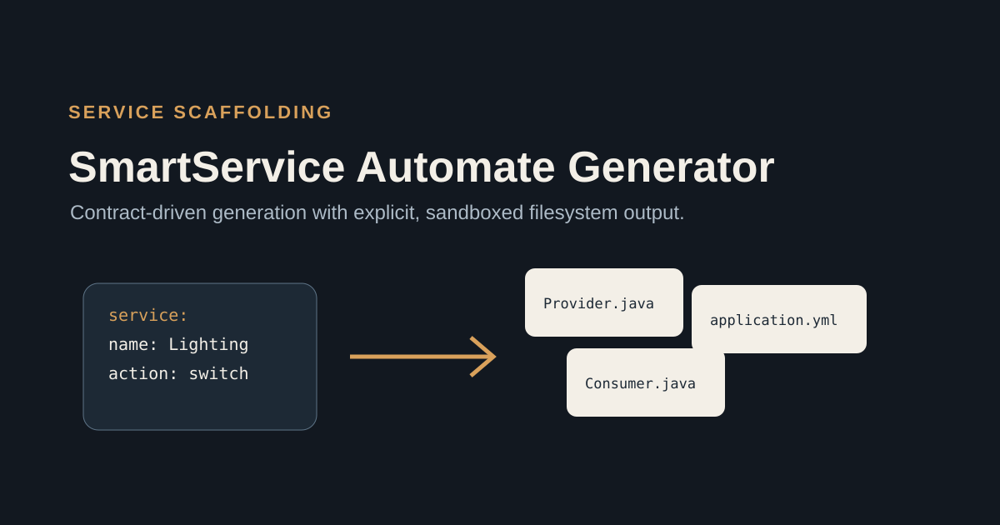
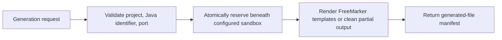

# SmartService-Automate-Generator

SmartService-Automate-Generator turns a bounded service description into a Java consumer scaffold for the IoT automation suite. It uses FreeMarker templates, validates every caller-controlled path segment, and writes only beneath a configured sandbox.

## Why it exists

An IoT rule can describe behavior without supplying the service boundary needed to run it. This project generates the repeatable project structure around that boundary: a Spring Boot entry point, controller, configuration, and Maven descriptor. The repository contains 13 FreeMarker templates; the safe consumer path currently uses four of them.

## Architecture



`ConsumerProjectGenerator` is the database-free generation core. `POST /genConsumer` is a thin HTTP adapter. A request cannot select an absolute output directory; `projectName` is resolved beneath `GENERATOR_OUTPUT_ROOT`. The target directory is reserved atomically, so concurrent requests with the same name have one winner. Existing projects are rejected rather than overwritten, and a rendering failure removes its partial reserved directory so the name can be retried.

## Safe local verification

Prerequisites: JDK 8 and Maven 3.8+.

```bash
JAVA_HOME=/path/to/jdk8 mvn test
```

The focused tests generate a complete consumer skeleton in a temporary directory and verify traversal, symbolic-link targets, invalid Java identifiers, invalid ports, concurrent same-name generation, failure cleanup, and the HTTP response boundary. They make no database or network connection.

To keep a generated fixture for suite integration, first install this project locally and then run the database-free CLI:

```bash
mvn install
mvn org.codehaus.mojo:exec-maven-plugin:3.1.0:java \
  -Dexec.mainClass=com.applet.mpinterface.framework.GeneratorCli \
  -Dexec.args="/tmp/smartservice-fixtures demo-consumer DemoConsumer 9094 examples/consumer-method.java.txt"
```

The generated project appears at `/tmp/smartservice-fixtures/demo-consumer`. The output root may exist, but the project directory must not.

## HTTP request

Set `GENERATOR_OUTPUT_ROOT` to a dedicated writable directory, configure the database-backed application endpoints if needed, and send:

```json
{
  "projectName": "weather-consumer",
  "appletName": "WeatherConsumer",
  "portNum": 9092,
  "javaCode": "public String health() { return \"ok\"; }"
}
```

The successful response contains only the caller-visible project name and project-relative files:

```json
{
  "projectName": "weather-consumer",
  "files": [
    "pom.xml",
    "src/main/resources/application.yaml",
    "src/main/java/com/weatherconsumer/mpinterface/MpInterfaceApplication.java",
    "src/main/java/com/weatherconsumer/mpinterface/controller/Controller.java"
  ]
}
```

The server's absolute output-root path is intentionally excluded from the HTTP representation. In-process callers retain access to the local `GenerationResult` path; the CLI receives its output root explicitly and prints only the relative manifest.

`genAddress` remains accepted as a compatibility alias for `projectName`, but it is interpreted as a project name inside the sandbox, never as an arbitrary filesystem path.

## Configuration

Copy `.env.example` into your own untracked environment configuration. Database settings have no embedded defaults. The generation core and its unit tests do not require a database. Database-backed metadata endpoints require `SMARTSERVICE_DB_URL`, `SMARTSERVICE_DB_USERNAME`, and `SMARTSERVICE_DB_PASSWORD`.

## Current boundaries

- Generated consumer projects reference adjacent RPC suite modules and are not standalone applications until those dependencies are published or installed locally.
- `javaCode` is emitted as source text. This project does not compile or execute it, and callers must treat generated source as untrusted until reviewed.
- Provider generation validates the applet class name and every database-derived method
  label before rendering, rejects duplicate/capitalization-colliding method names,
  and renders lookup labels as escaped Java string literals. It confines every output below the caller-owned root, rejects symbolic-link segments, renders in memory, writes atomically, and propagates failures. Filesystems without atomic moves fail closed;
  the historical adapter publishes individual files, not a whole-project transaction. It remains a metadata-bound historical adapter; the typed provider generator under SmartHome Integrated Logic Management is the maintained path.
- The repository has no release or compatibility guarantee yet.

## License status

No open-source license has been selected. `RIGHTS.md` records the source-visible, no-reuse-grant status and preserves GitHub platform permissions and third-party rights.
